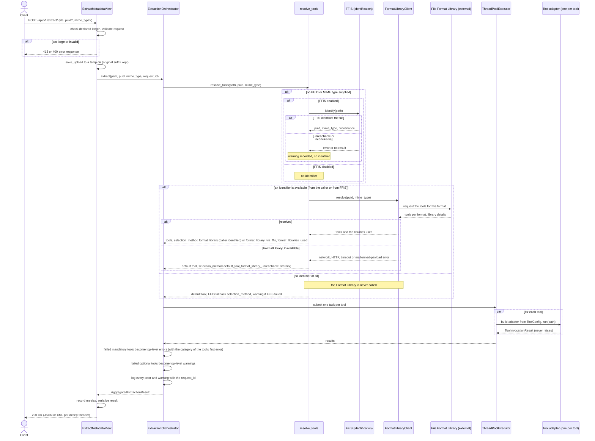
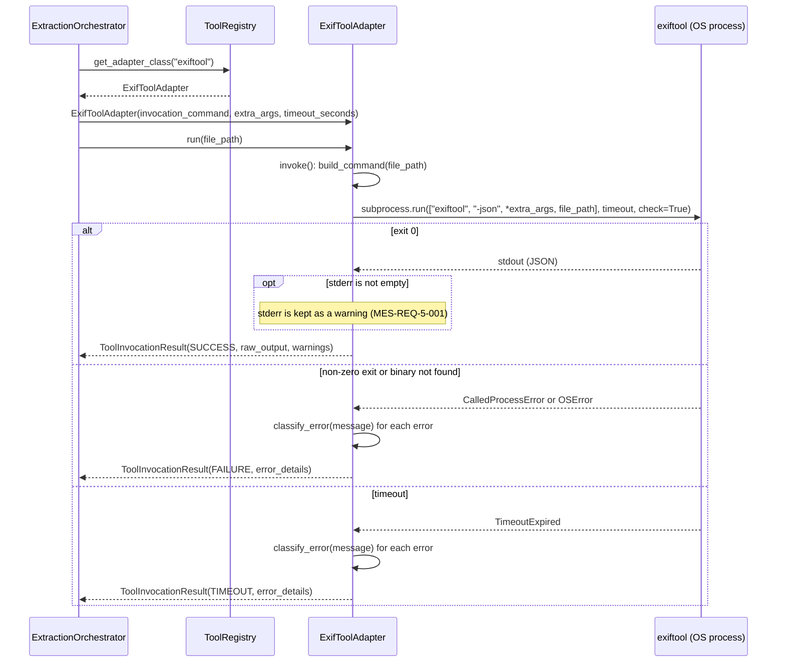
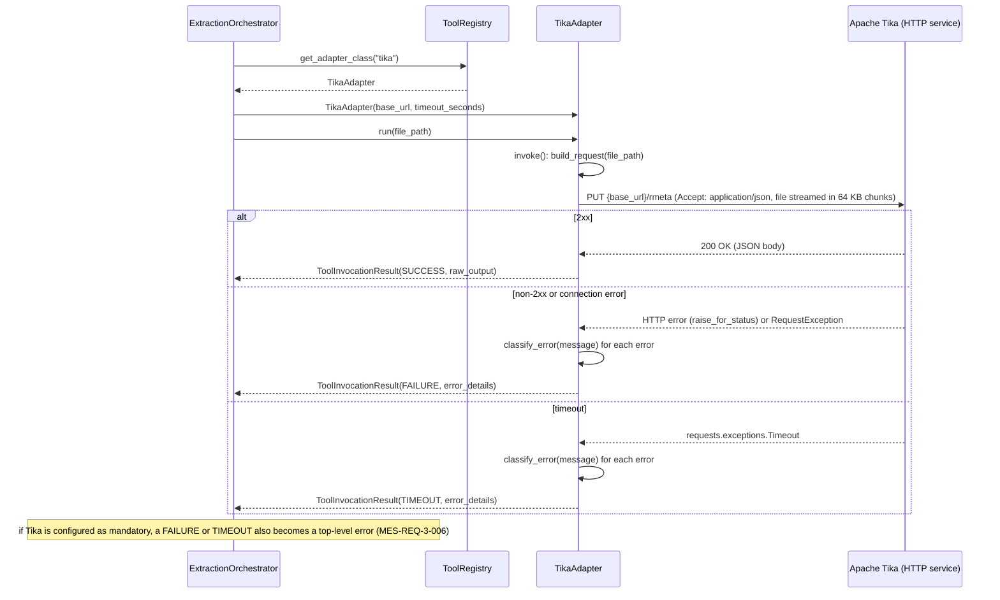
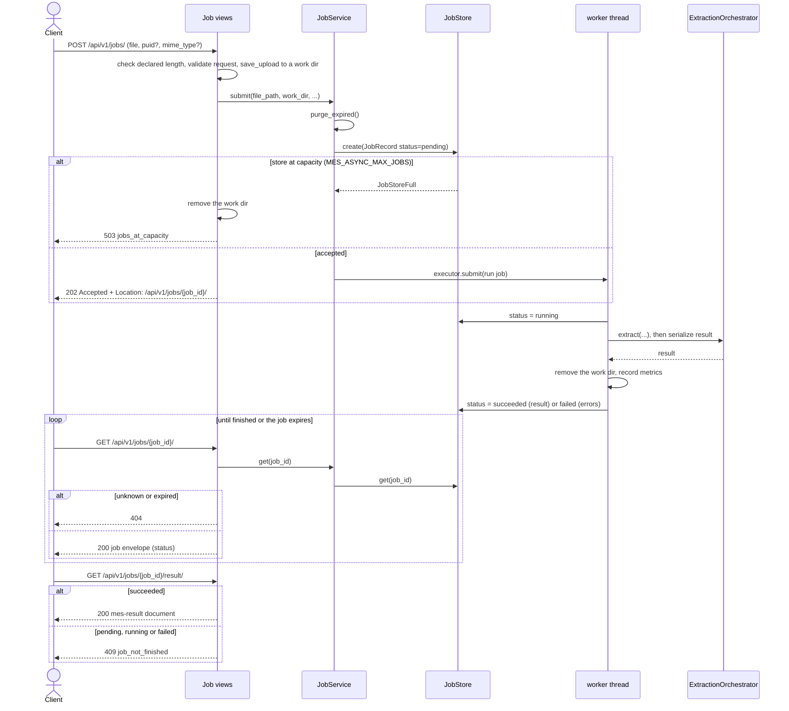
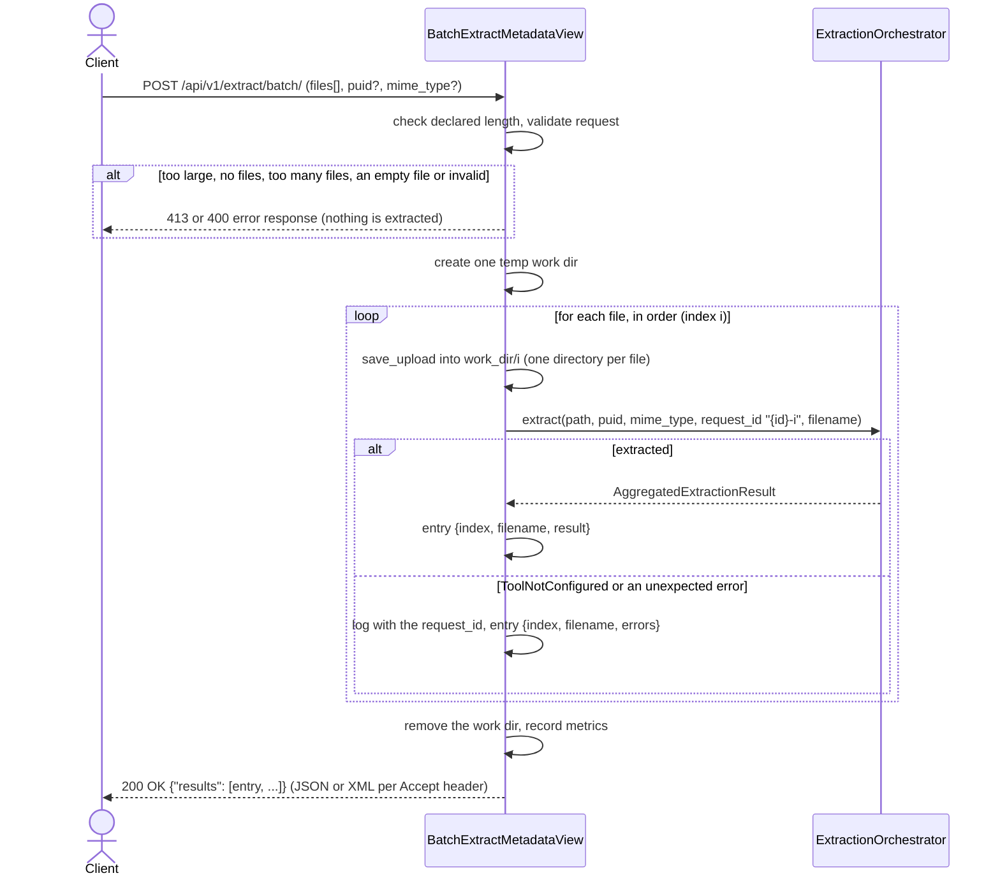
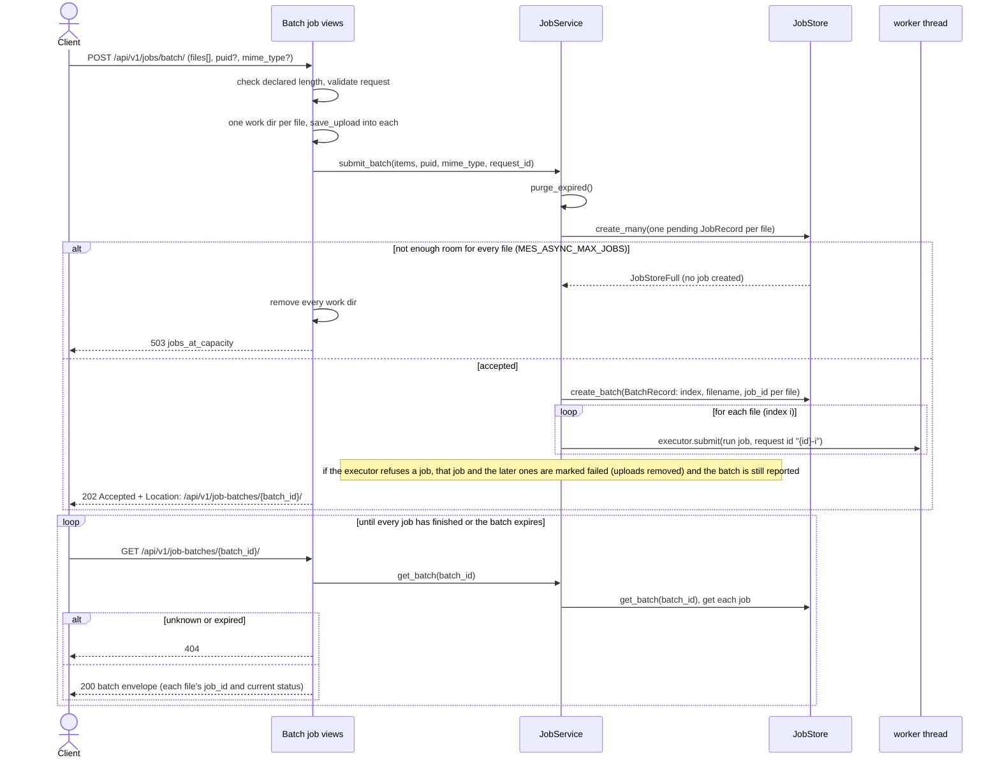

# Architecture Diagrams

These diagrams show how a request flows through MES and how the **tool adapters** are invoked.

{{ MES-REQ-1-005 }} requires the wrapper to invoke each configured extraction tool either as a
**local CLI subprocess** (ExifTool, MediaInfo, FFprobe, ImageMagick, metaflac) or as an
**externally hosted HTTP service** (Apache Tika). Both integration paths sit behind the same adapter
abstraction, so adding a tool never requires changes to the orchestrator (Requirement Group 4,
{{ MES-REQ-4-007 }}).

The choice between the two paths is a tool-integration concern, not a client-facing one: in both
cases the client talks to MES through the same REST API (Requirement Group 2). The difference is
entirely in how the *wrapper* talks to the underlying tool.

Diagrams:

1. [Synchronous extraction](#sequence-diagram--synchronous-extraction-post-apiv1extract) — the full request flow
2. [Local CLI tool path](#sequence-diagram--local-cli-tool-path-exiftool) — what a subprocess adapter does
3. [Hosted HTTP service path](#sequence-diagram--hosted-http-service-path-apache-tika) — what an HTTP adapter does
4. [Asynchronous job](#sequence-diagram--asynchronous-job-post-apiv1jobs) — submit, poll, fetch the result
5. [Synchronous batch](#sequence-diagram--synchronous-batch-post-apiv1extractbatch) — several files in one request
6. [Asynchronous batch](#sequence-diagram--asynchronous-batch-post-apiv1jobsbatch) — one job per file, polled as a batch

## Sequence diagram — synchronous extraction (`POST /api/v1/extract/`)

The complete request flow. Tools are resolved first: the file is identified (by the caller, or by FFIS
when the caller gave no identifier), and the identifier is sent to the File Format Library, which
returns the extraction tools for that format and the libraries consulted ({{ MES-REQ-3-009 }}). If the
Format Library cannot be reached, or there is no identifier, MES falls back to the configured default
tool ({{ MES-REQ-1-001 }}). The resolved tools then run concurrently in a thread pool bounded by
`MES_MAX_CONCURRENT_TOOLS`. The two per-tool paths are shown in detail in the next two diagrams.

Failure handling ({{ MES-REQ-3-006 }}, {{ MES-REQ-3-008 }}, {{ MES-REQ-5-001 }}): a failed tool is always
reported in its own result and never discards the other tools' results. Every error carries a
category (`encrypted`, `truncated_or_broken`, `wrong_format` or `unknown`) assigned by the adapter
(see the two per-tool diagrams); warnings are not categorised. A failed **optional** tool
also adds a top-level *warning*; a failed **mandatory** tool adds a top-level *error*. No tool is
mandatory in the default `MES_TOOLS` configuration.

## Sequence diagram — local CLI tool path (ExifTool)

What `run()` does for a `SubprocessToolAdapter`. `run()` never raises: whatever `invoke()` throws is
mapped to a status. Each error message is labelled by the adapter's `classify_error()` (its own
`error_patterns`; `unknown` when nothing matches), and `error_details` holds `(message, category)` pairs.

## Sequence diagram — hosted HTTP service path (Apache Tika)

The same `run()` template, with a different `invoke()` and transport. Only the adapter differs; the
orchestrator and the API are unchanged.

## Sequence diagram — asynchronous job (`POST /api/v1/jobs/`)

{{ MES-REQ-3-010 }}. The job runs the same `extract()` as the synchronous endpoint, so its result is
identical. The `/jobs/` routes answer 404 when `MES_ASYNC_ENABLED` is off. Job state lives in the job
store (in memory or Redis, chosen by `MES_JOB_STORE`).

A finished job's data is kept for `MES_JOB_TTL_SECONDS`; expired jobs and their uploads are purged on
access and on submit.

## Sequence diagram — synchronous batch (`POST /api/v1/extract/batch/`)

Several files in one multipart request (the `files` field repeated once per file; at most
`MES_MAX_FILES_PER_REQUEST`, advertised by `GET /limits/`). `puid` and `mime_type` apply to every file;
`object_identifier` is not accepted, because each file is identified by its filename. The files are
processed one after another, and each goes through the same `extract()` as `/extract/`, so its `result`
equals what that route returns for it. A request that is not acceptable (no files, too many, an empty
file, too large) is refused as a whole before anything runs. Once accepted, a file that fails gets an
`errors` entry in its place and the others are unaffected, so the response is `200`.

## Sequence diagram — asynchronous batch (`POST /api/v1/jobs/batch/`)

The batch counterpart of the asynchronous job, available when `MES_ASYNC_ENABLED` is on (the routes
answer 404 otherwise). It queues one ordinary job per file, **all or none**: the job store must have
room for every file, or nothing is created. Each job then runs, and is polled and fetched, exactly as
in the previous async diagram (`GET /jobs/{job_id}/` and `/jobs/{job_id}/result/`). The batch adds only
a grouping record, so the client can poll all the jobs with one request.

Each job in a batch is kept for `MES_JOB_TTL_SECONDS` like any other job.
