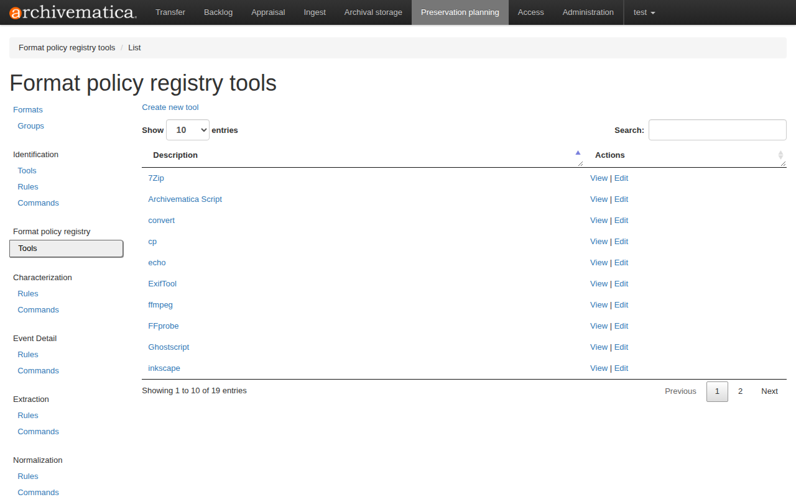
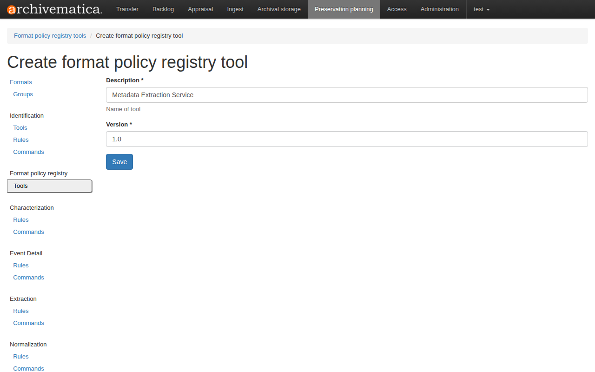
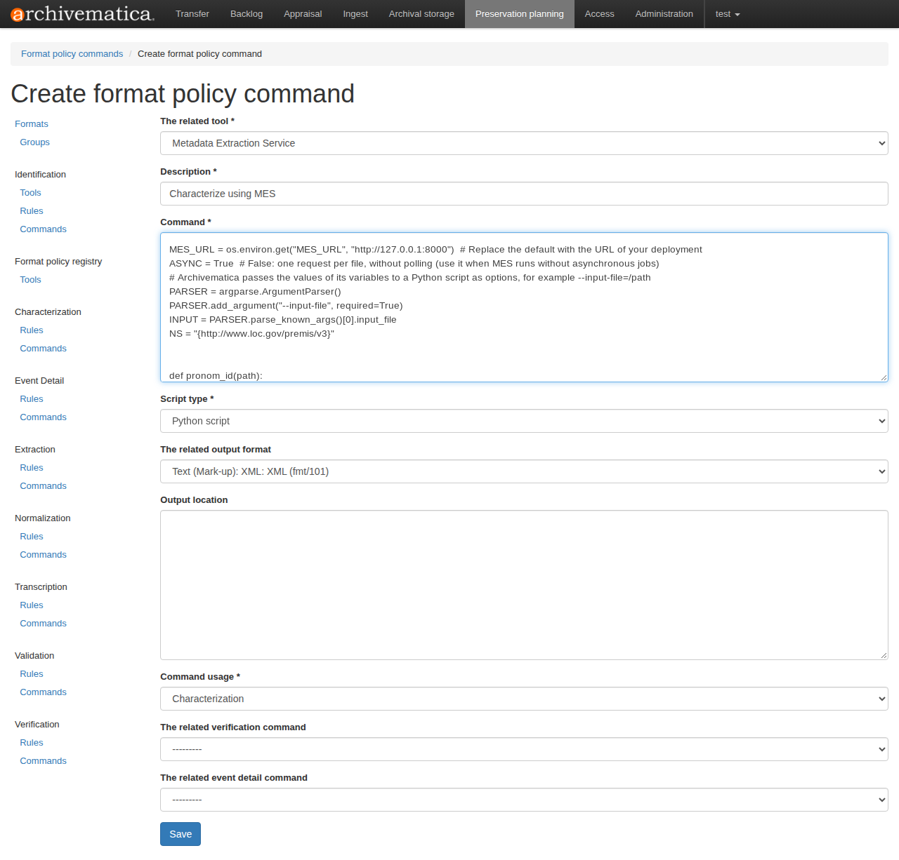
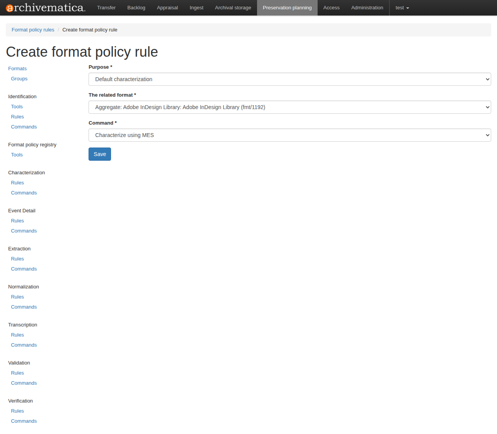
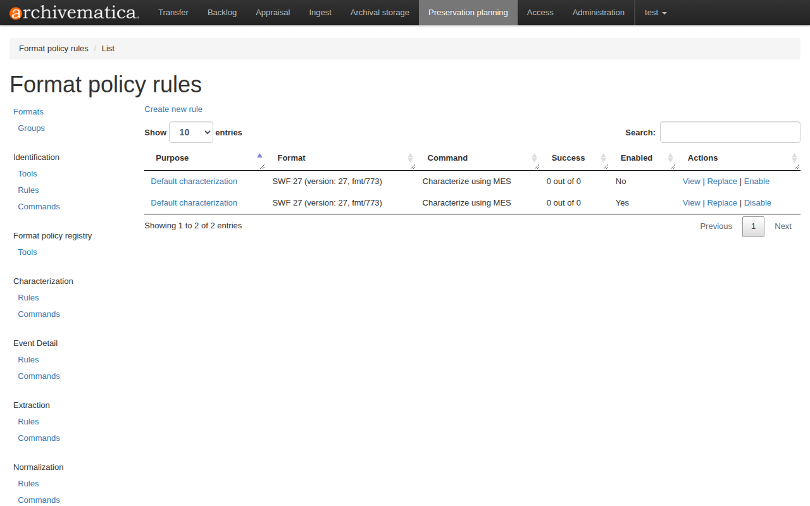

# Integrate Archivematica

[Archivematica](https://archivematica.org/en/) characterises each file during ingest by running a *characterization command* from its Format Policy Registry (FPR). It stores the XML that the command prints in the file's PREMIS `objectCharacteristicsExtension`. This page registers MES as such a command.

MES has no command-line mode of its own. The command is a small Python script, stored in the FPR, that sends the file to the MES REST API and prints one XML document with the output of every tool that succeeded.

## What Archivematica stores

`objectCharacteristicsExtension` is meant for the XML of the characterisation tools themselves, with **one root element**. MES usually runs several tools for a file, so the command puts the unchanged output of **every tool that succeeded** under one wrapper element:

```xml
<characterization>
  <toolOutput tool="exiftool" format="xml">
    <rdf:RDF xmlns:rdf="http://www.w3.org/1999/02/22-rdf-syntax-ns#">…</rdf:RDF>
  </toolOutput>
  <toolOutput tool="ffprobe" format="xml">
    <ffprobe>…</ffprobe>
  </toolOutput>
  <toolOutput tool="tika" format="json">
    <rawOutput>{"…": "…"}</rawOutput>
  </toolOutput>
</characterization>
```

- Each tool's XML is embedded **unchanged**, with its own namespaces; only its XML declaration is removed. The `format` attribute is the tool's output format (`xml`, `json` or `text`).
- Output that is not XML (JSON, text) goes into `rawOutput` as escaped text. If it has characters XML cannot carry, or a carriage return, it is base64-encoded and `rawOutput` has `encoding="base64"`. XML that is not well-formed (or has a `DOCTYPE`) is kept as text in the same way.
- A tool that failed, timed out or produced nothing is left out.
- The wrapper elements (`characterization`, `toolOutput`, `rawOutput`) have no namespace, because the extension accepts any element; each tool's XML keeps its own. There is no schema for the wrapper.
- Which tools are stored is decided by MES: the tools of the matching [local format rules](local-format-rules.md), or the default tool when no rule matches.
- The PREMIS events, the agents, the tool selection and the FFIS identification of MES are not stored; only the tools' outputs are.

## How it works

1. Archivematica runs the command for a file. A Python script gets the values of Archivematica's variables as options, for example `--input-file=/path/to/file`.
2. The script finds the file's PRONOM ID by running `sf -json` (siegfried), as Archivematica's identification step does, and sends it as `puid` when it has one. Without a PRONOM ID it sends none.
3. By default (`ASYNC = True`) the script uploads the file with `POST /api/v1/jobs/`, polls `GET /api/v1/jobs/{job_id}/` until the job has succeeded, and fetches `GET /api/v1/jobs/{job_id}/result/?raw=exact` as `application/premis+xml`. With `ASYNC = False` it makes one request, `POST /api/v1/extract/?raw=exact`, and gets the same document. It takes the exact output of every tool whose event succeeded out of the PREMIS document, builds the wrapper document and prints it on standard output.
4. If the job fails, times out, MES is unreachable or no tool succeeded, the script writes a message to standard error and exits non-zero, with nothing on standard output.

MES chooses the extraction tools itself. Archivematica needs one command, not one per tool. The script reads `MES_URL` from the environment of the command and default to `http://127.0.0.1:8000`. That only reaches MES when the command runs in the same network namespace as MES. From the Archivematica container, use the address of the Docker host (for example `http://172.17.0.1:8000`) or a service name on a shared Docker network,, and add that host name to MES's `DJANGO_ALLOWED_HOSTS` (MES refuses any other `Host` with `400 Bad Request`); edit the default in the script. The script needs only `requests` and `sf` (siegfried), which the Archivematica client image has (checked in the image of this deployment: Python 3.9, requests 2.32, siegfried 1.11).

## MES is the default characterization

This example registers MES as the **default characterization** (purpose `default_characterization`), not as a rule for one format.

!!! important "When MES runs, and when it does not"
    Archivematica runs the default characterization for **every file format that has no characterization rule**. If a rule exists for a format, the command assigned to that rule runs and **MES is bypassed** for those files. To have MES characterize such a format too, edit its rule so that it uses the MES command.

    Check **Characterization**, **Rules** in the FPR to see which formats already have a rule.

## Register MES

Use either the web UI or the SQL script. Both create the same three FPR records: a tool, a command and a rule.

### With the Archivematica web UI

Open the dashboard and sign in. Then go to **Preservation planning**. The left menu lists the FPR sections used below.

**1. Create the tool.**

Under **Format policy registry**, click **Tools**, then **Create new tool**.



Enter the description `Metadata Extraction Service` and the version `1.0`, then click **Save**.



**2. Create the command.**

Under **Characterization**, click **Commands**, then **Create new command**, and fill in the form:

| Field | Value |
|---|---|
| The related tool | `Metadata Extraction Service` |
| Description | `Characterize using MES` |
| Command | The script below |
| Script type | `Python script` |
| The related output format | `Text (Mark-up): XML: XML (fmt/101)` |
| Command usage | `Characterization` |

Leave the other fields empty and click **Save**.



!!! warning
    Set the output format to XML (fmt/101). Archivematica only stores the output of a characterization command when that format is set. Otherwise it logs that the output is not XML and does not save it.

!!! note
    For a Python script, Archivematica does not replace `%inputFile%` in the text. It passes the values as options (`--input-file=…`), which the script reads.

```python
import argparse
import base64
import json
import os
import re
import subprocess
import sys
import time
import xml.etree.ElementTree as ET
from xml.sax.saxutils import escape

import requests

MES_URL = "http://127.0.0.1:8000"  # Replace the default with the URL of your deployment
ASYNC = True  # False: one request per file, without polling (use it when MES runs without asynchronous jobs)
# Archivematica passes the values of its variables to a Python script as options, for example --input-file=/path
PARSER = argparse.ArgumentParser()
PARSER.add_argument("--input-file", required=True)
INPUT = PARSER.parse_known_args()[0].input_file
NS = "{http://www.loc.gov/premis/v3}"


def pronom_id(path):
    """The PRONOM ID, found as Archivematica's identification step finds it (siegfried); None if there is none."""
    try:
        output = subprocess.check_output(["sf", "-json", path], stderr=subprocess.DEVNULL)
        match = json.loads(output)["files"][0]["matches"][0]
    except (OSError, subprocess.CalledProcessError, ValueError, LookupError):
        return None
    puid = match.get("puid") or match.get("id") or ""
    return puid if re.fullmatch(r"(x-)?fmt/[0-9]+", puid) else None


def mes(method, path, **kwargs):
    response = requests.request(method, MES_URL + path, timeout=300, **kwargs)
    response.raise_for_status()
    return response


def tool_outputs(premis):
    """(tool, format, text) of every tool that succeeded, taken from the PREMIS document."""
    root = ET.fromstring(premis)
    tools = {}  # agent UUID -> tool name; the first agentNote of a tool agent is "Tool: <name>"
    for agent in root.iter(NS + "agent"):
        note = agent.findtext(NS + "agentNote") or ""
        if note.startswith("Tool: "):
            tools[agent.findtext(f"{NS}agentIdentifier/{NS}agentIdentifierValue")] = note[len("Tool: "):]
    for event in root.iter(NS + "event"):
        # Only a tool that succeeded has the exact copy of its output: a rawOutput with a sha256 (from ?raw=exact).
        raw = event.find(f".//{NS}eventOutcomeDetailExtension/rawOutput[@sha256]")
        agent = event.findtext(f"{NS}linkingAgentIdentifier/{NS}linkingAgentIdentifierValue")
        if raw is None or agent not in tools:
            continue
        text = base64.b64decode(raw.text).decode("utf-8") if raw.get("encoding") == "base64" else raw.text or ""
        if text:
            yield tools[agent], raw.get("format"), text


def characterization(premis):
    """One XML document with the unchanged output of every tool that succeeded."""
    parts = []
    for tool, fmt, text in tool_outputs(premis):
        body = None
        if fmt == "xml":
            body = re.sub(r"^\s*<\?xml[^>]*\?>\s*", "", text)  # the XML of the tool, without its declaration
            try:
                ET.fromstring(body)
            except ET.ParseError:
                body = None
        if body is None:  # not XML: as text, or as base64 if the text would not survive as XML
            body = "<rawOutput>" + escape(text) + "</rawOutput>"
            try:
                if ET.fromstring(body).text != text:
                    raise ValueError(text)
            except (ET.ParseError, ValueError):
                body = '<rawOutput encoding="base64">' + base64.b64encode(text.encode()).decode() + "</rawOutput>"
        parts.append(f'<toolOutput tool="{tool}" format="{fmt}">{body}</toolOutput>')
    if not parts:
        sys.exit("MES: no successful tool output")
    return "<characterization>" + "".join(parts) + "</characterization>"


try:
    puid = pronom_id(INPUT)
    JSON, PREMIS = {"Accept": "application/json"}, {"Accept": "application/premis+xml"}
    with open(INPUT, "rb") as upload:
        form = {"files": {"file": upload}, "data": {"puid": puid} if puid else None}
        if ASYNC:
            job = mes("POST", "/api/v1/jobs/", headers=JSON, **form).json()["job_id"]
        else:
            result = mes("POST", "/api/v1/extract/?raw=exact", headers=PREMIS, **form).content
    if ASYNC:
        for _ in range(600):
            status = mes("GET", f"/api/v1/jobs/{job}/", headers=JSON).json()["status"]
            if status in ("succeeded", "failed"):
                break
            time.sleep(1)
        if status != "succeeded":
            sys.exit(f"MES: job {job} did not succeed (status {status})")
        result = mes("GET", f"/api/v1/jobs/{job}/result/?raw=exact", headers=PREMIS).content
    document = characterization(result)
except (requests.RequestException, ET.ParseError, ValueError, LookupError) as error:
    sys.exit(f"MES: {error}")
sys.stdout.write(document)
```

The script asks for JSON (`Accept: application/json`) when it submits a job and polls it, and for the PREMIS document (`Accept: application/premis+xml`) when it fetches the result. `?raw=exact` adds the unmodified text of every tool's output with its SHA-256. Without it the PREMIS document holds only a parsed copy of XML output, and the script would find no exact output.

The default, `ASYNC = True`, uses the asynchronous job routes, so MES must run with `MES_ASYNC_ENABLED=true` and Redis (see [Use asynchronous jobs and Redis](async-jobs.md)). Set `ASYNC = False` if MES runs without asynchronous jobs, or you prefer one request per file. The HTTP connection then stays open while MES extracts, so a slow file or a proxy timeout below 300 seconds fails the command; the asynchronous version avoids that by polling with short requests.

**3. Create the default rule.**

Under **Characterization**, click **Rules**, then **Create new rule**, and fill in the form:

| Field | Value |
|---|---|
| Purpose | `Default characterization` |
| The related format | Any entry. The form requires one, but Archivematica ignores it for a default rule. |
| Command | `Characterize using MES` |

Click **Save**.



**4. Check the result.**

Open **Characterization**, **Rules**, and pick the purpose **Default characterization**. The rule that uses `Characterize using MES` must be listed as enabled. Only one enabled default characterization rule is needed.



To change the script later, use **Replace** next to the command. Archivematica keeps the old version in the revision history and points the rule at the new one.

### With the SQL script

The script below creates the same tool, command and default rule in one transaction. It was written for Archivematica 1.18 and is safe to run again: the tool and command use fixed UUIDs and the command text is refreshed.

Save it as `archivematica-fpr.sql` and run it against the dashboard database (`MCP`) of the Archivematica Docker Compose setup:

```bash
docker compose exec -T mysql mysql -uroot -p12345 MCP < archivematica-fpr.sql
```

Edit the `@mes_command` variable first if MES is not reachable at `http://127.0.0.1:8000`, or to use `ASYNC = False`. If you change the script, double every backslash and every single quote in it (`\` becomes `\\`, `'` becomes `''`), because MySQL reads both in a string literal.

```sql
-- Archivematica 1.18 FPR: register MES as a characterization tool and
-- make it the default characterization (used for files with no
-- format-specific characterization rule).
--
-- Run against the Archivematica dashboard database, e.g.
--   docker compose exec -T mysql mysql -uroot -p12345 MCP < sql
--
-- Safe to re-run: the tool and command use fixed UUIDs (the command text is
-- refreshed) and the rule is only inserted if missing.
--
-- Tables: fpr_fptool, fpr_fpcommand, fpr_fprule (fpr_fpcommand.tool_id and
-- fpr_fprule.command_id reference the uuid columns, not the integer ids).
-- Edit the command below to match how MES is deployed.

START TRANSACTION;

INSERT INTO fpr_fptool (uuid, enabled, description, version, slug)
SELECT '7d4e1c2a-5b0f-4a43-9c1e-3f6a8b2d9e10', 1,
       'Metadata Extraction Service', '1.0', 'mes'
WHERE NOT EXISTS (
    SELECT 1 FROM fpr_fptool WHERE uuid = '7d4e1c2a-5b0f-4a43-9c1e-3f6a8b2d9e10'
);

-- The command is a Python script (script type pythonScript): upload the file as an
-- asynchronous job, poll the job until it finishes, then build one XML document with the
-- output of every tool that succeeded and print it on stdout (which is what Archivematica
-- stores in objectCharacteristicsExtension). PLEASE replace the default value of MES_URL with
-- the url of your deployment. In the SQL string every backslash and every single quote of the
-- script is doubled, because MySQL reads both.
SET @mes_command = 'import argparse
import base64
import json
import os
import re
import subprocess
import sys
import time
import xml.etree.ElementTree as ET
from xml.sax.saxutils import escape

import requests

MES_URL = "http://127.0.0.1:8000"  # Replace the default with the URL of your deployment
ASYNC = True  # False: one request per file, without polling (use it when MES runs without asynchronous jobs)
# Archivematica passes the values of its variables to a Python script as options, for example --input-file=/path
PARSER = argparse.ArgumentParser()
PARSER.add_argument("--input-file", required=True)
INPUT = PARSER.parse_known_args()[0].input_file
NS = "{http://www.loc.gov/premis/v3}"


def pronom_id(path):
    """The PRONOM ID, found as Archivematica''s identification step finds it (siegfried); None if there is none."""
    try:
        output = subprocess.check_output(["sf", "-json", path], stderr=subprocess.DEVNULL)
        match = json.loads(output)["files"][0]["matches"][0]
    except (OSError, subprocess.CalledProcessError, ValueError, LookupError):
        return None
    puid = match.get("puid") or match.get("id") or ""
    return puid if re.fullmatch(r"(x-)?fmt/[0-9]+", puid) else None


def mes(method, path, **kwargs):
    response = requests.request(method, MES_URL + path, timeout=300, **kwargs)
    response.raise_for_status()
    return response


def tool_outputs(premis):
    """(tool, format, text) of every tool that succeeded, taken from the PREMIS document."""
    root = ET.fromstring(premis)
    tools = {}  # agent UUID -> tool name; the first agentNote of a tool agent is "Tool: <name>"
    for agent in root.iter(NS + "agent"):
        note = agent.findtext(NS + "agentNote") or ""
        if note.startswith("Tool: "):
            tools[agent.findtext(f"{NS}agentIdentifier/{NS}agentIdentifierValue")] = note[len("Tool: "):]
    for event in root.iter(NS + "event"):
        # Only a tool that succeeded has the exact copy of its output: a rawOutput with a sha256 (from ?raw=exact).
        raw = event.find(f".//{NS}eventOutcomeDetailExtension/rawOutput[@sha256]")
        agent = event.findtext(f"{NS}linkingAgentIdentifier/{NS}linkingAgentIdentifierValue")
        if raw is None or agent not in tools:
            continue
        text = base64.b64decode(raw.text).decode("utf-8") if raw.get("encoding") == "base64" else raw.text or ""
        if text:
            yield tools[agent], raw.get("format"), text


def characterization(premis):
    """One XML document with the unchanged output of every tool that succeeded."""
    parts = []
    for tool, fmt, text in tool_outputs(premis):
        body = None
        if fmt == "xml":
            body = re.sub(r"^\\s*<\\?xml[^>]*\\?>\\s*", "", text)  # the XML of the tool, without its declaration
            try:
                ET.fromstring(body)
            except ET.ParseError:
                body = None
        if body is None:  # not XML: as text, or as base64 if the text would not survive as XML
            body = "<rawOutput>" + escape(text) + "</rawOutput>"
            try:
                if ET.fromstring(body).text != text:
                    raise ValueError(text)
            except (ET.ParseError, ValueError):
                body = ''<rawOutput encoding="base64">'' + base64.b64encode(text.encode()).decode() + "</rawOutput>"
        parts.append(f''<toolOutput tool="{tool}" format="{fmt}">{body}</toolOutput>'')
    if not parts:
        sys.exit("MES: no successful tool output")
    return "<characterization>" + "".join(parts) + "</characterization>"


try:
    puid = pronom_id(INPUT)
    JSON, PREMIS = {"Accept": "application/json"}, {"Accept": "application/premis+xml"}
    with open(INPUT, "rb") as upload:
        form = {"files": {"file": upload}, "data": {"puid": puid} if puid else None}
        if ASYNC:
            job = mes("POST", "/api/v1/jobs/", headers=JSON, **form).json()["job_id"]
        else:
            result = mes("POST", "/api/v1/extract/?raw=exact", headers=PREMIS, **form).content
    if ASYNC:
        for _ in range(600):
            status = mes("GET", f"/api/v1/jobs/{job}/", headers=JSON).json()["status"]
            if status in ("succeeded", "failed"):
                break
            time.sleep(1)
        if status != "succeeded":
            sys.exit(f"MES: job {job} did not succeed (status {status})")
        result = mes("GET", f"/api/v1/jobs/{job}/result/?raw=exact", headers=PREMIS).content
    document = characterization(result)
except (requests.RequestException, ET.ParseError, ValueError, LookupError) as error:
    sys.exit(f"MES: {error}")
sys.stdout.write(document)';

-- characterize_file.py only stores a command's stdout when the command's output format is
-- fmt/101 (XML); otherwise it logs "Tool output ... is not XML; not saving to database".
SET @xml_format = (SELECT MIN(uuid) FROM fpr_formatversion WHERE pronom_id = 'fmt/101');

INSERT INTO fpr_fpcommand (
    uuid, enabled, lastmodified, tool_id, description, command, script_type,
    output_location, output_format_id, command_usage,
    verification_command_id, event_detail_command_id, replaces_id
)
SELECT 'b3a9f0d4-61c8-4e27-8d5b-0a1c7e94f2a6', 1, NOW(6),
       '7d4e1c2a-5b0f-4a43-9c1e-3f6a8b2d9e10', 'Characterize using MES',
       @mes_command, 'pythonScript',
       NULL, @xml_format, 'characterization', NULL, NULL, NULL
WHERE NOT EXISTS (
    SELECT 1 FROM fpr_fpcommand WHERE uuid = 'b3a9f0d4-61c8-4e27-8d5b-0a1c7e94f2a6'
);

-- Re-running updates the command of an existing install.
UPDATE fpr_fpcommand
SET command = @mes_command, script_type = 'pythonScript',
    output_format_id = @xml_format, lastmodified = NOW(6)
WHERE uuid = 'b3a9f0d4-61c8-4e27-8d5b-0a1c7e94f2a6';

-- Default characterization rule: characterize_file.py falls back to all enabled
-- rules with purpose 'default_characterization' when a file has no
-- format-specific rule. fpr_fprule.format_id is NOT NULL, but is ignored for
-- this purpose, so any existing format version satisfies the constraint.
INSERT INTO fpr_fprule (
    uuid, enabled, lastmodified, purpose, command_id, format_id,
    count_attempts, count_okay, count_not_okay, replaces_id
)
SELECT UUID(), 1, NOW(6), 'default_characterization',
       'b3a9f0d4-61c8-4e27-8d5b-0a1c7e94f2a6',
       (SELECT MIN(uuid) FROM fpr_formatversion), 0, 0, 0, NULL
WHERE NOT EXISTS (
    SELECT 1 FROM fpr_fprule
    WHERE command_id = 'b3a9f0d4-61c8-4e27-8d5b-0a1c7e94f2a6'
      AND purpose = 'default_characterization'
);

COMMIT;
```

## Try it

Start a transfer in Archivematica with a file whose format has no characterization rule. After ingest, open the file's PREMIS object. The MES output is inside `objectCharacteristicsExtension`: one `characterization` element with a `toolOutput` for every tool that succeeded.

## Limits

- A job that finishes with some failed tools still counts as `succeeded`, and the script exits `0`. The XML holds the tools that succeeded. If no tool succeeded, the script exits non-zero.
- The output is one root element with each tool's XML under it, as MES-REQ-6-007 (XML suitable for `objectCharacteristicsExtension`) asks. Two limits remain. The wrapper has no schema. And MES-REQ-6-008 (a valid, declared namespace for every schema represented) depends on the tool, because each tool's XML keeps the namespace it has: FFprobe's XML has none.
- The specification's command-line mode (MES-REQ-6-001 to 6-012) is not implemented as such. The scripts approximate it with the REST API: they print the result on standard output, exit non-zero on failure and then print nothing.
- The PRONOM ID comes from running siegfried again in the command, not from Archivematica's own identification result, so it can differ if Archivematica identifies with another tool or version. `sf` has to be available where the command runs. Archivematica's identification step runs it, so it should be installed there, but check this on your deployment.
- The script uploads every file, so mind the [upload limits](limits-and-purging.md).
