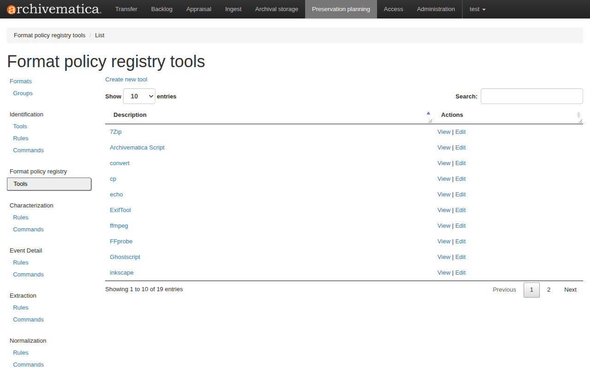
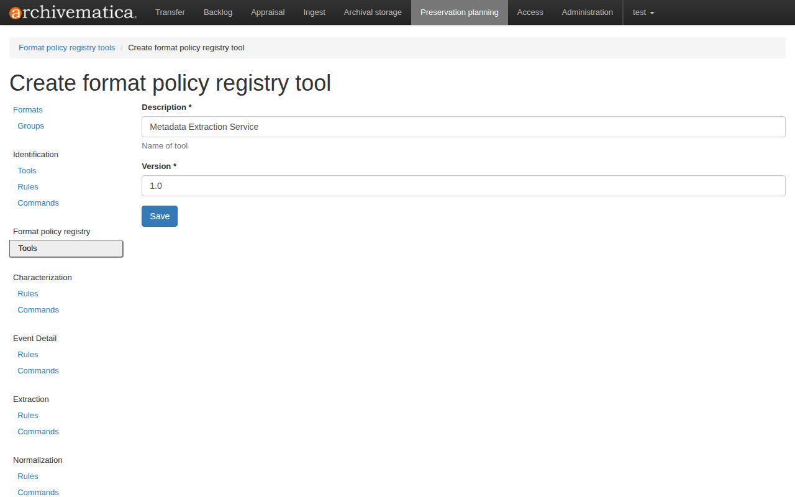
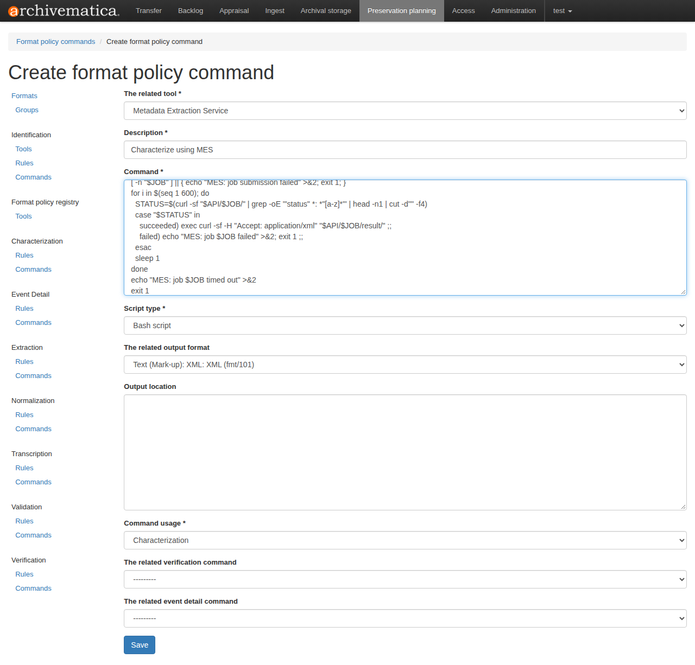
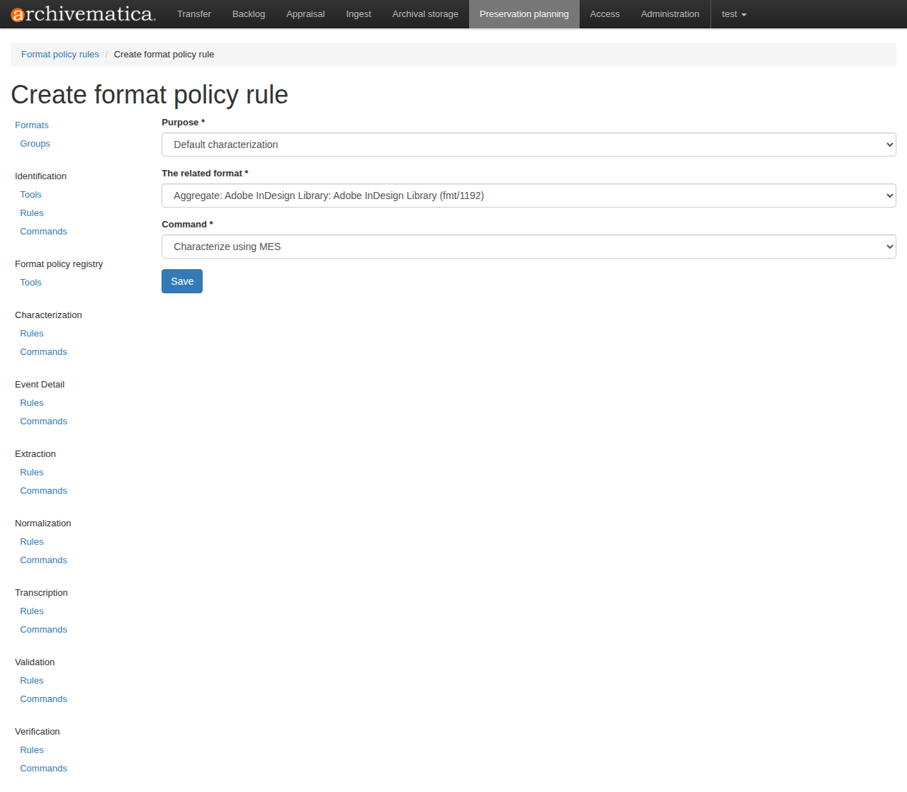
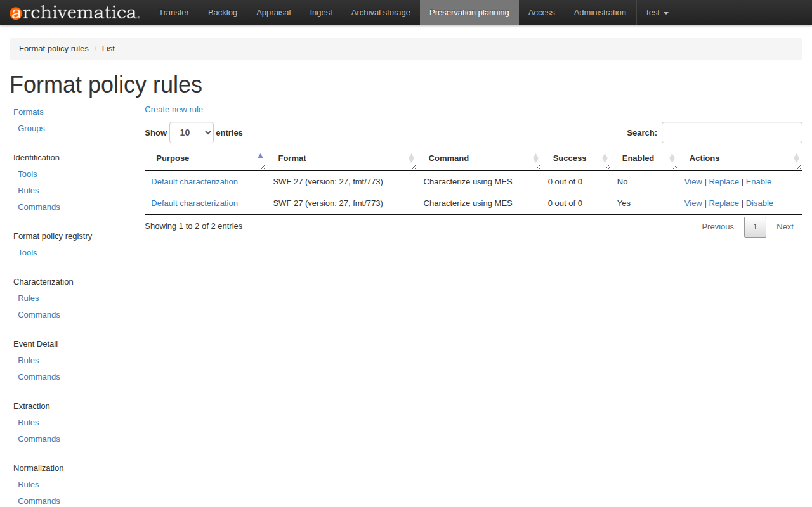

# Integrate Archivematica

[Archivematica](https://archivematica.org/en/) characterises each file during ingest by running a *characterization command* from its Format Policy Registry (FPR). It stores the XML that the command prints in the file's PREMIS `objectCharacteristicsExtension`. This page registers MES as such a command.

MES has no command-line mode of its own. The command is a small bash script, stored in the FPR, that sends the file to the MES REST API and prints the XML result.

## How it works

1. Archivematica runs the command for a file and replaces `%inputFile%` with the file's path.
2. In the asynchronous version, the script uploads the file with `POST /api/v1/jobs/`, polls `GET /api/v1/jobs/{job_id}/` until the job has succeeded, and then prints `GET /api/v1/jobs/{job_id}/result/` with `Accept: application/xml` on standard output.
3. If the job fails, times out or MES is unreachable, the script writes a message to standard error and exits non-zero, with nothing on standard output.

MES chooses the extraction tools itself. Archivematica needs one command, not one per tool. Set `MES_URL` in the environment of the Archivematica worker to change the address of MES. It defaults to `http://172.17.0.1:8000`, the Docker host as seen from a container.

## MES is the default characterization

This example registers MES as the **default characterization** (purpose `default_characterization`), not as a rule for one format.

!!! important "When MES runs, and when it does not"
    Archivematica runs the default characterization for **every file format that has no characterization rule**. If a rule exists for a format, the command assigned to that rule runs and **MES is bypassed** for those files. To have MES characterize such a format too, edit its rule so that it uses the MES command.

    Check **Characterization**, **Rules** in the FPR to see which formats already have a rule.

## Register MES

Use either the web UI or the SQL script. Both create the same three FPR records: a tool, a command and a rule.

### With the Archivematica web UI

Open the dashboard and sign in. Then go to **Preservation planning**. The left menu lists the FPR sections used below.

**1. Create the tool.**

Under **Format policy registry**, click **Tools**, then **Create new tool**.



Enter the description `Metadata Extraction Service` and the version `1.0`, then click **Save**.



**2. Create the command.**

Under **Characterization**, click **Commands**, then **Create new command**, and fill in the form:

| Field | Value |
|---|---|
| The related tool | `Metadata Extraction Service` |
| Description | `Characterize using MES` |
| Command | The asynchronous script below, or the [synchronous variant](#synchronous-variant) |
| Script type | `Bash script` |
| The related output format | `Text (Mark-up): XML: XML (fmt/101)` |
| Command usage | `Characterization` |

Leave the other fields empty and click **Save**.



!!! warning
    Set the output format to XML (fmt/101). Archivematica only stores the output of a characterization command when that format is set. Otherwise it logs that the output is not XML and does not save it.

```bash
MES_URL="http://172.17.0.1:8000" # Replace MES_URL value with URL of you deployment
API="$MES_URL/api/v1/jobs"
JOB=$(curl -sf --max-time 300 -F "file=@%inputFile%" "$API/" | grep -oE '"job_id" *: *"[^"]*"' | cut -d'"' -f4)
[ -n "$JOB" ] || { echo "MES: job submission failed" >&2; exit 1; }
for i in $(seq 1 600); do
  STATUS=$(curl -sf "$API/$JOB/" | grep -oE '"status" *: *"[a-z]*"' | head -n1 | cut -d'"' -f4)
  case "$STATUS" in
    succeeded) exec curl -sf -H "Accept: application/xml" "$API/$JOB/result/" ;;
    failed) echo "MES: job $JOB failed" >&2; exit 1 ;;
  esac
  sleep 1
done
echo "MES: job $JOB timed out" >&2
exit 1
```

The script parses the JSON with `grep` and `cut`, so no `jq` is needed in the Archivematica container. It uses the asynchronous job routes, so MES must run with `MES_ASYNC_ENABLED=true` and Redis (see [Use asynchronous jobs and Redis](async-jobs.md)).

#### Synchronous variant

If MES runs without asynchronous jobs, or you prefer one request per file, use this command instead. It calls `POST /api/v1/extract/`, which returns the result in the same response:

```bash
MES_URL="http://172.17.0.1:8000" # Replace MES_URL value with URL of you deployment
OUT=$(curl -sf --max-time 300 -H "Accept: application/xml" -F "file=@%inputFile%" "$MES_URL/api/v1/extract/") \
  || { echo "MES: extraction request failed" >&2; exit 1; }
printf '%s\n' "$OUT"
```

The script prints to standard output only after a successful response, so a failure leaves no partial XML. The trade-off is that the HTTP connection stays open while MES extracts, so a slow file or a proxy timeout below 300 seconds fails the command. The asynchronous version avoids that by polling with short requests.

**3. Create the default rule.**

Under **Characterization**, click **Rules**, then **Create new rule**, and fill in the form:

| Field | Value |
|---|---|
| Purpose | `Default characterization` |
| The related format | Any entry. The form requires one, but Archivematica ignores it for a default rule. |
| Command | `Characterize using MES` |

Click **Save**.



**4. Check the result.**

Open **Characterization**, **Rules**, and pick the purpose **Default characterization**. The rule that uses `Characterize using MES` must be listed as enabled. Only one enabled default characterization rule is needed.



To change the script later, use **Replace** next to the command. Archivematica keeps the old version in the revision history and points the rule at the new one.

### With the SQL script

The script below creates the same tool, command and default rule in one transaction. It was written for Archivematica 1.18 and is safe to run again: the tool and command use fixed UUIDs and the command text is refreshed.

Save it as `archivematica-fpr.sql` and run it against the dashboard database (`MCP`) of the Archivematica Docker Compose setup:

```bash
docker compose exec -T mysql mysql -uroot -p12345 MCP < archivematica-fpr.sql
```

Edit the `@mes_command` variable first if MES is not reachable at `http://172.17.0.1:8000`, or to use the [synchronous variant](#synchronous-variant).

```sql
-- Archivematica 1.18 FPR: register MES as a characterization tool and
-- make it the default characterization (used for files with no
-- format-specific characterization rule).
--
-- Run against the Archivematica dashboard database, e.g.
--   docker compose exec -T mysql mysql -uroot -p12345 MCP < sql
--
-- Safe to re-run: the tool and command use fixed UUIDs (the command text is
-- refreshed) and the rule is only inserted if missing.
--
-- Tables: fpr_fptool, fpr_fpcommand, fpr_fprule (fpr_fpcommand.tool_id and
-- fpr_fprule.command_id reference the uuid columns, not the integer ids).
-- Edit the command below to match how MES is deployed.

START TRANSACTION;

INSERT INTO fpr_fptool (uuid, enabled, description, version, slug)
SELECT '7d4e1c2a-5b0f-4a43-9c1e-3f6a8b2d9e10', 1,
       'Metadata Extraction Service', '1.0', 'mes'
WHERE NOT EXISTS (
    SELECT 1 FROM fpr_fptool WHERE uuid = '7d4e1c2a-5b0f-4a43-9c1e-3f6a8b2d9e10'
);

-- The command is a bash script: upload the single file as an asynchronous job,
-- poll the job until it finishes, then print the XML result on stdout (which is
-- what Archivematica stores in objectCharacteristicsExtension). PLEASE replace te value of
-- MES_URL the url of your deployment; JSON is parsed with grep/cut so no jq is needed.
SET @mes_command = 'MES_URL="http://172.17.0.1:8000"
API="$MES_URL/api/v1/jobs"
JOB=$(curl -sf --max-time 300 -F "file=@%inputFile%" "$API/" | grep -oE ''"job_id" *: *"[^"]*"'' | cut -d''"'' -f4)
[ -n "$JOB" ] || { echo "MES: job submission failed" >&2; exit 1; }
for i in $(seq 1 600); do
  STATUS=$(curl -sf "$API/$JOB/" | grep -oE ''"status" *: *"[a-z]*"'' | head -n1 | cut -d''"'' -f4)
  case "$STATUS" in
    succeeded) exec curl -sf -H "Accept: application/xml" "$API/$JOB/result/" ;;
    failed) echo "MES: job $JOB failed" >&2; exit 1 ;;
  esac
  sleep 1
done
echo "MES: job $JOB timed out" >&2
exit 1';

-- characterize_file.py only stores a command's stdout when the command's output format is
-- fmt/101 (XML); otherwise it logs "Tool output ... is not XML; not saving to database".
SET @xml_format = (SELECT MIN(uuid) FROM fpr_formatversion WHERE pronom_id = 'fmt/101');

INSERT INTO fpr_fpcommand (
    uuid, enabled, lastmodified, tool_id, description, command, script_type,
    output_location, output_format_id, command_usage,
    verification_command_id, event_detail_command_id, replaces_id
)
SELECT 'b3a9f0d4-61c8-4e27-8d5b-0a1c7e94f2a6', 1, NOW(6),
       '7d4e1c2a-5b0f-4a43-9c1e-3f6a8b2d9e10', 'Characterize using MES',
       @mes_command, 'bashScript',
       NULL, @xml_format, 'characterization', NULL, NULL, NULL
WHERE NOT EXISTS (
    SELECT 1 FROM fpr_fpcommand WHERE uuid = 'b3a9f0d4-61c8-4e27-8d5b-0a1c7e94f2a6'
);

-- Re-running updates the command of an existing install.
UPDATE fpr_fpcommand
SET command = @mes_command, script_type = 'bashScript',
    output_format_id = @xml_format, lastmodified = NOW(6)
WHERE uuid = 'b3a9f0d4-61c8-4e27-8d5b-0a1c7e94f2a6';

-- Default characterization rule: characterize_file.py falls back to all enabled
-- rules with purpose 'default_characterization' when a file has no
-- format-specific rule. fpr_fprule.format_id is NOT NULL, but is ignored for
-- this purpose, so any existing format version satisfies the constraint.
INSERT INTO fpr_fprule (
    uuid, enabled, lastmodified, purpose, command_id, format_id,
    count_attempts, count_okay, count_not_okay, replaces_id
)
SELECT UUID(), 1, NOW(6), 'default_characterization',
       'b3a9f0d4-61c8-4e27-8d5b-0a1c7e94f2a6',
       (SELECT MIN(uuid) FROM fpr_formatversion), 0, 0, 0, NULL
WHERE NOT EXISTS (
    SELECT 1 FROM fpr_fprule
    WHERE command_id = 'b3a9f0d4-61c8-4e27-8d5b-0a1c7e94f2a6'
      AND purpose = 'default_characterization'
);

COMMIT;
```

## Try it

Start a transfer in Archivematica with a file whose format has no characterization rule. After ingest, open the file's PREMIS object. The MES result is inside `objectCharacteristicsExtension`. The `provenance` block in the result names the tools that ran.

## Limits

- A job that finishes with some failed tools still counts as `succeeded`. The script exits `0` and the failures are in the XML (see [Result container and statuses](../reference/result-container.md)).
- MES returns its own result container. Check that your Archivematica version accepts it inside `objectCharacteristicsExtension`.
- The script uploads every file, so mind the [upload limits](limits-and-purging.md).
