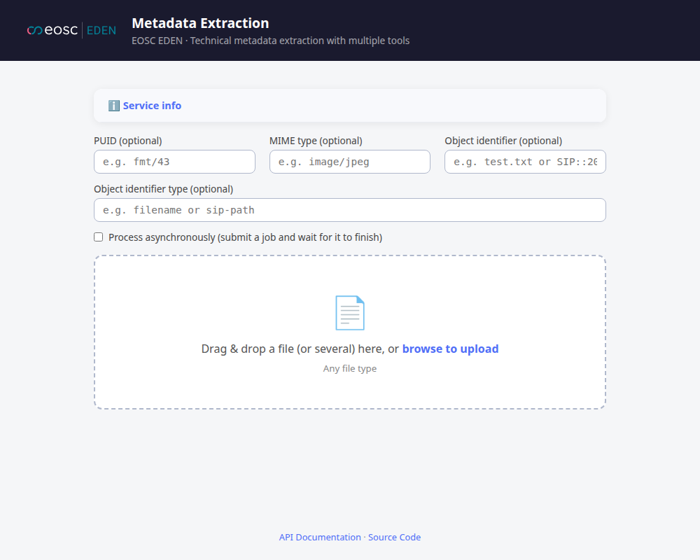
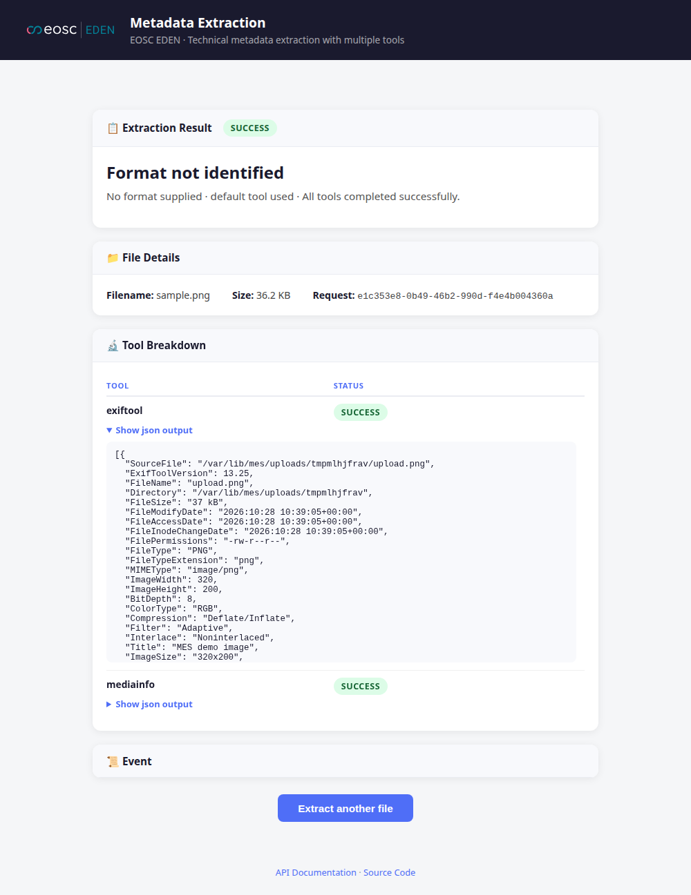

# First extraction in the web UI

The service ships a single-page web UI at its root, so you can extract metadata without `curl`. In this tutorial you extract metadata from one file and read the result.

The screenshots were taken from a service with the default settings: only ExifTool and MediaInfo are enabled. Yours may show more tools.

## 1. Open the UI

Start the service as in [First extraction with curl](first-extraction-curl.md) and open <http://localhost:8000/>.

- **Service info** (collapsed) lists the enabled tools and the deployment limits.
- The optional fields let you name the file's format (PUID or MIME type) yourself, and give the file's PREMIS object an identifier. Leave them empty to let MES work it out.
- **Process asynchronously** submits a job and waits for it to finish. It is only shown when `MES_ASYNC_ENABLED` is `true`.

## 2. Choose a file

Drop a file on the drop zone, or click **browse to upload**. You can select several files; at most `max_files_per_request` are accepted (see `/api/v1/limits/`). The extraction starts at once.

## 3. Read the result

From top to bottom:

- **Extraction Result** shows the overall status and the format. Without a PUID, a MIME type or [FFIS](../how-to/ffis.md), the format is shown as "Format not identified", as here. The extraction still runs.
- **File Details** shows the filename, its size and the `request_id`, which you can find in the service logs.
- **Tool Breakdown** lists each tool with its status. **Show json output** (or **text output**) reveals the tool's unmodified output.
- Failed tools, errors and warnings get their own cards, and **Event** holds the PREMIS extraction event.

## 4. Extract another file

Choose **Extract another file** to return to the start.

## Footer

The footer links to the Swagger UI (`/api/v1/docs/`), to the source code and, when `MES_DOCS_URL` is set, to this documentation. `MES_FOOTER_TEXT` adds a short note, for example a funding acknowledgement.

The UI only talks to the [REST API](../reference/rest-api.md); everything it shows is available there.
