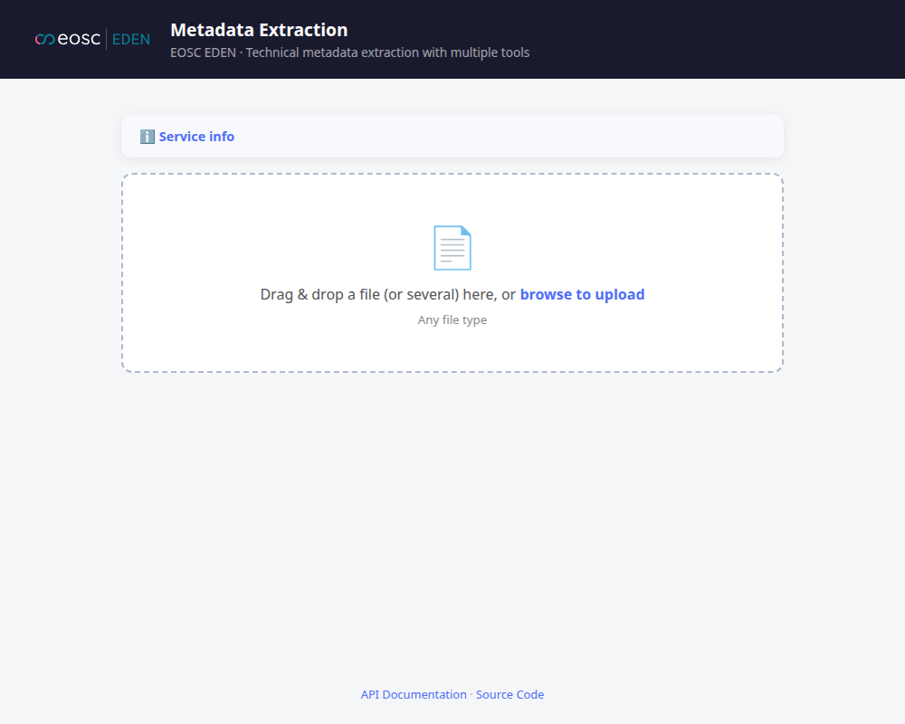
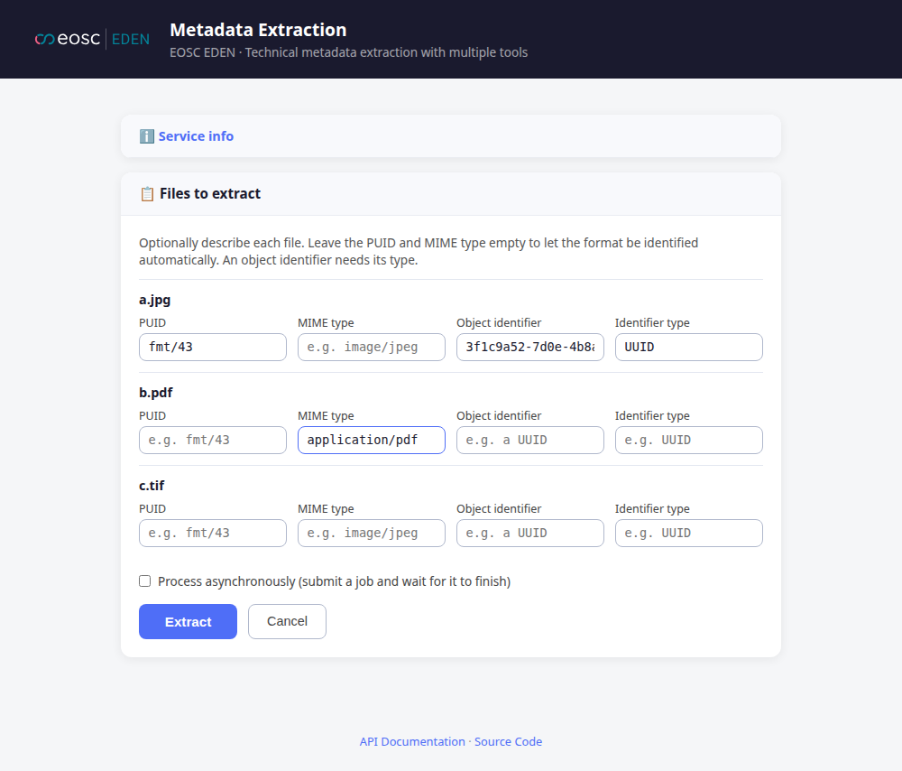
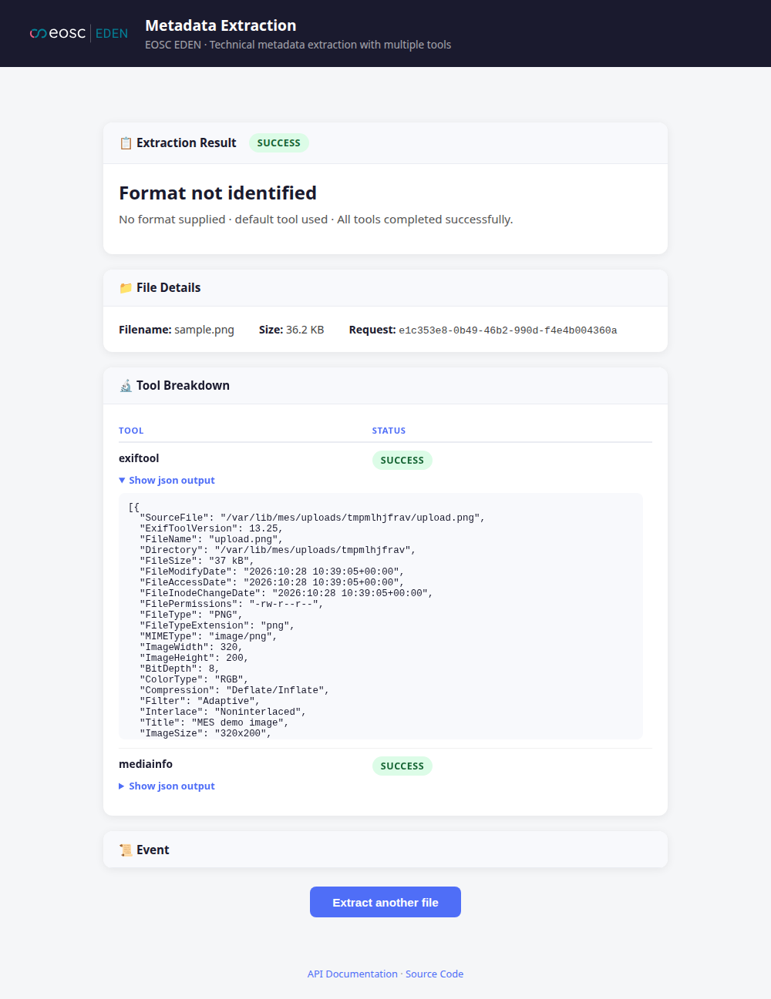

# First extraction in the web UI

The service ships a single-page web UI at its root, so you can extract metadata without `curl`. In this tutorial you extract metadata from one file and read the result.

The screenshots were taken from a service with the default settings: only ExifTool and MediaInfo are enabled. Yours may show more tools.

## 1. Open the UI

Start the service as in [First extraction with curl](first-extraction-curl.md) and open <http://localhost:8000/>.

- **Service info** (collapsed) lists the enabled tools and the deployment limits.
- The drop zone is where you choose your files.

## 2. Choose a file

Drop a file on the drop zone, or click **browse to upload**.

You can select several files. At most `max_files_per_request` are accepted (see `/api/v1/limits/`). Several files are submitted as an asynchronous batch (`/api/v1/jobs/batch/`) when the service has asynchronous processing enabled, and otherwise sent one after another to `/api/v1/extract/`. The **Files to extract** section lists each file, but nothing is sent for processing until you click **Extract**.

For each file you can optionally fill in:

- **PUID** or **MIME type**, to enter the file format yourself. Leave them empty to let MES identify the file format.
- **Object identifier** and **Identifier type**, to give the file's PREMIS object an identifier. Fill in both or neither: an identifier without a type (or a type without an identifier) is not accepted.

**Process asynchronously** submits a job and waits for it to finish. It is only shown when `MES_ASYNC_ENABLED` is `true`. It matters for a single file only: several files are always submitted as a batch of jobs when asynchronous processing is on.

Choose **Extract** to start, or **Cancel** to go back and pick other files.

## 3. Read the result

From top to bottom:

- **Extraction Result** shows the overall status and the format. Without a PUID, a MIME type or [FFIS](../how-to/ffis.md), the format is shown as "Format not identified", as seen above. The metadata extraction still runs if the file format is not identified.
- **File Details** shows the filename, its size and the `request_id`, which you can find in the service logs.
- **Tool Breakdown** lists each tool with its status. **Show json output** (or **text output**) reveals the tool's unmodified output.
- Failed tools, errors and warnings get their own cards, and **Event** shows the PREMIS summary event (the tools that ran, how they were selected, the outcome) and the agents. The tool events and the file object are in the API response.

## 4. Extract another file

Choose **Extract another file** to return to the start.

## Footer

The footer links to the Swagger UI (`/api/v1/docs/`), to the source code and, when `MES_DOCS_URL` is set, to this documentation. `MES_FOOTER_TEXT` adds a short note, for example a funding acknowledgement.

The UI only talks to the [REST API](../reference/rest-api.md); everything it shows is available there.
