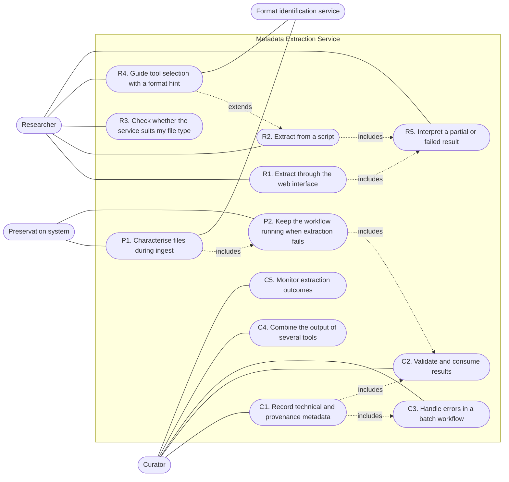
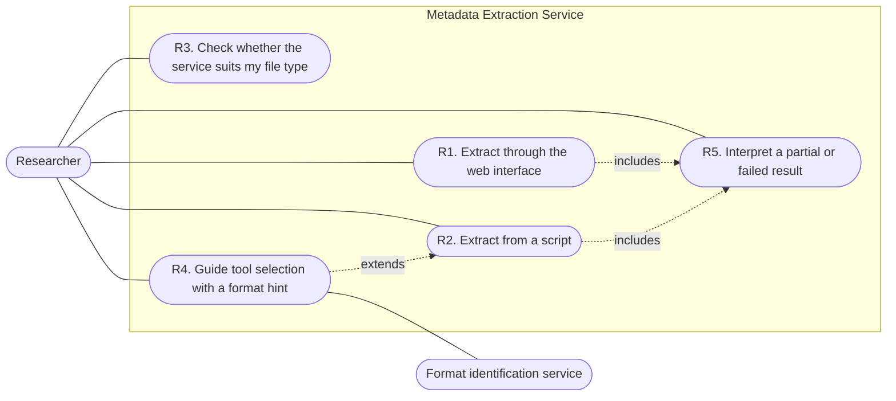
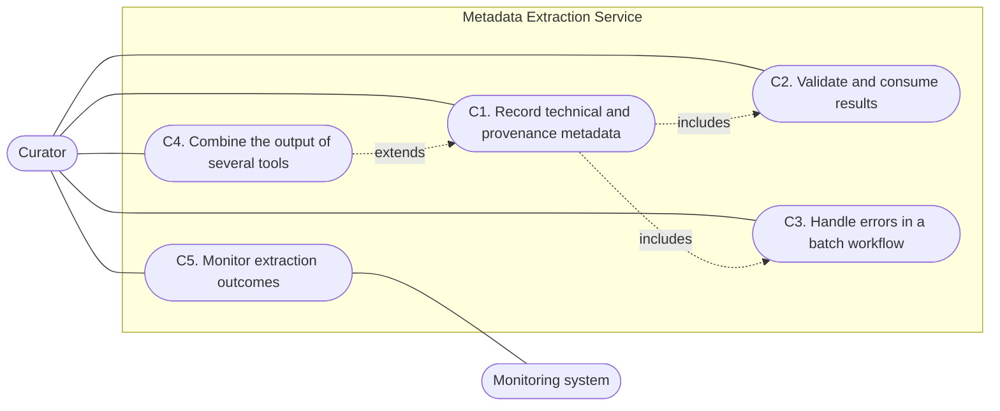
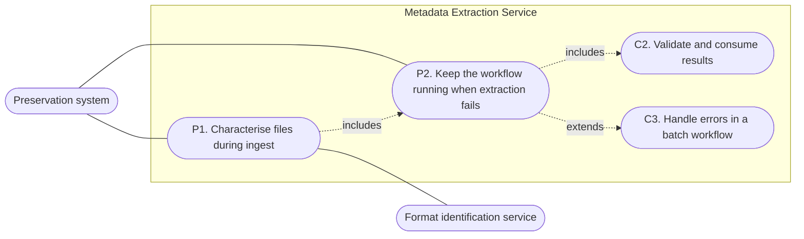
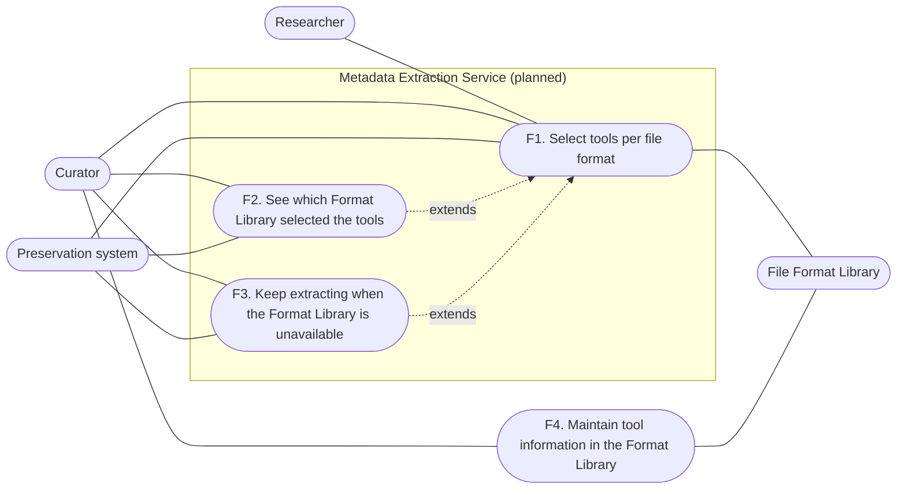

# Use Cases

**The primary goal of the Metadata Extraction Service (MES) is to extract TECHNICAL metadata from digital files.** Technical metadata describes the properties of the file itself, such as its format, size, encoding, dimensions, duration, colour space or embedded properties. The service runs one or more extraction tools on a single file and returns each tool's raw, unmodified output together with the tool's name, version and execution status. It also records provenance information about the extraction itself, so the origin of every piece of technical metadata is known.

The service does not create descriptive metadata, such as titles, authors or subjects, and it does not judge the quality or validity of a file. It reports what the tools find.

This document describes how the service is used by three actors: the **researcher**, the **curator** and the **preservation system**. See also the [specification](specification.md).

## Actors

| Actor | Goal | Typical way of working |
|---|---|---|
| Researcher | Inspect the technical properties of a file they work with, without installing extraction tools. | The web interface, or a single request from a script |
| Curator | Capture technical and provenance metadata for digital objects in a repository or Trusted Digital Archive, as part of ingest, appraisal or preservation planning. | Scripts and preservation workflows that call the service |
| Preservation system | Automatically characterise files inside a preservation workflow, such as ingest, and record the result in the information package. Archivematica is one example. Other repository or archive platforms can play the same role. | Calls the service by itself, without human interaction |

The curator and the preservation system overlap. The curator is the person who decides what to capture and how to react to problems. The preservation system is the software that calls the service on the curator's behalf.

Operators, who configure tools, limits and monitoring, are out of scope here. See [adding-a-tool.md](adding-a-tool.md).

## Use case diagram

Actors are drawn outside the system boundary and use cases inside it. A dashed arrow from one use case to another means the first one builds on the second.

The preservation system works on the curator's behalf, so the curator also reviews the failures that P2 records (C3).

## Researcher use cases

### R1. Extract metadata through the web interface

- **Goal:** see the technical metadata of a file without using the command line.
- **Precondition:** the file is within the maximum size shown on the page.
- **Main flow:**
  1. The researcher opens the web interface. It shows the maximum file size and the tools that are available.
  2. The researcher drops or selects a file and starts the extraction.
  3. The interface shows the identified format, any errors and warnings, and the output of each tool.
  4. The researcher can choose to extract another file.
- **Alternative flows:** an empty file or a file that is too large is rejected with a clear message, and no tool runs (see R5).
- **Outcome:** the researcher can read the raw output of every tool that ran.
- **Requirements:** MES-REQ-2-004, MES-REQ-2-006, MES-REQ-3-001.

### R2. Extract metadata from a script

- **Goal:** get machine-readable output for one file.
- **Main flow:**
  1. The researcher sends the file to the service in a single request.
  2. The researcher chooses whether the answer comes back as JSON (the default) or XML.
  3. The answer contains one entry per tool, with the tool, its version, whether it succeeded, and its raw output.
- **Outcome:** a result that follows the published schema (see C2).
- **Requirements:** MES-REQ-2-001, MES-REQ-2-002, MES-REQ-2-005, MES-REQ-3-004, MES-REQ-3-007.

### R3. Check whether the service suits my file type

- **Goal:** decide, before uploading, whether the available tools cover the researcher's data.
- **Main flow:**
  1. The researcher looks up the list of tools. For each tool it shows whether it is enabled, whether it is mandatory, whether it is the default, and how long it may run.
  2. The researcher looks up the largest file size the service accepts.
- **Outcome:** the researcher knows which tools can run and the largest file the service accepts. How the tools are started is not shown.
- **Requirements:** the Introduction of the [specification](specification.md), which says the available tools must be exposed.

### R4. Guide tool selection with a format hint

- **Goal:** select the right tools when the format is already known, or understand how the service chose them.
- **Main flow:**
  1. The researcher adds the format to the request, as a PRONOM identifier (PUID) or a MIME type.
  2. The service maps that format to the configured tools.
  3. The result states which format was used, which tools were chosen, and how the choice was made: from the researcher's hint, from automatic identification, or from the default.
- **Alternative flows:** without a hint, the service asks the File Format Identification Service (FFIS) to identify the file. If identification is switched off, unavailable or inconclusive, the service uses the default tools and adds a warning that explains why.
- **Outcome:** the researcher can tell whether the tools were chosen from their hint, from identification, or from the default.
- **Requirements:** MES-REQ-1-001, MES-REQ-1-004, MES-REQ-2-006 (second occurrence, "PUID or mime type"), MES-REQ-3-010.

### R5. Interpret a partial or failed result

- **Goal:** understand what went wrong and still use what worked.
- **Main flow:**
  1. The researcher checks whether each tool succeeded, failed or ran out of time.
  2. The researcher reads the errors and warnings of each tool and of the request as a whole.
  3. The researcher uses the output of the tools that succeeded. A failing tool does not discard the other tools' results, unless that tool is configured as mandatory. In that case the request as a whole reports an error.
- **Alternative flows:** a request can also be refused as a whole. This happens when the file is missing or empty, when the format hint is invalid, when the file is larger than the maximum size, when a required tool is not configured, or when something unexpected goes wrong. In every case the researcher gets a readable message and a reference number. No internal details are shown.
- **Outcome:** the researcher knows which tools produced usable metadata and can quote the reference number when asking for help.
- **Requirements:** MES-REQ-3-006, MES-REQ-3-008, MES-REQ-5-001.

## Curator use cases

### C1. Record technical and provenance metadata during ingest

- **Goal:** attach technical metadata, with provenance, to a digital object in the repository or archive.
- **Precondition:** the workflow can send one file per request.
- **Main flow:**
  1. The ingest workflow sends each file to the service, together with its format when format identification has already run.
  2. The workflow stores the raw output of each tool together with the tool, its version, the start and end time, and the output format.
  3. The workflow also stores the provenance information of the result (when it was made, which service version, which tool versions, and which identification service was consulted) and the request's reference number.
- **Outcome:** the stored metadata names the tool and version behind each element. Because the output is not modified, it can be re-interpreted later. This also supports significant properties recorded as technical metadata (QUALITY-TECHNICAL-REQ-016).
- **Requirements:** MES-REQ-3-001, MES-REQ-3-002, MES-REQ-3-004, MES-REQ-3-007, MES-REQ-3-008.

### C2. Validate and consume results programmatically

- **Goal:** build or maintain an integration without guessing the structure of the result.
- **Main flow:**
  1. The curator or integrator downloads the service's published description: the API description, a schema for JSON results and a schema for XML results. An interactive page for trying out the API is also available.
  2. The integration checks each result against the schema before storing it.
- **Outcome:** the top-level structure is stable and can be checked by machine, while the content of each tool's output stays specific to that tool.
- **Requirements:** MES-REQ-2-001, MES-REQ-2-005.

### C3. Handle errors in a batch workflow

- **Goal:** process many files without silent loss.
- **Main flow:**
  1. The workflow checks whether the request was accepted. A refused request always comes with a readable message and a reference number.
  2. For an accepted request, the workflow checks the outcome of each tool and the errors of the request as a whole. It then classifies the file as complete, partial or failed.
  3. The workflow passes the reference number to the operator, who finds the matching log entries.
  4. For a file that is too large, the workflow looks up the maximum size and sends the file to another process.
- **Alternative flows:** when the service is temporarily unable to process a file, the workflow retries later or flags the file for manual review.
- **Outcome:** each file ends in a known state and can be traced in the logs.
- **Requirements:** MES-REQ-3-006, MES-REQ-3-008, MES-REQ-5-001.

### C4. Combine the output of several tools for one file

- **Goal:** obtain complementary metadata, because no single tool covers every property.
- **Main flow:**
  1. The curator checks which tools are enabled.
  2. A single request runs all tools chosen for the file. The result holds one entry per tool.
  3. The curator compares the outputs, for example to assess quality or to decide which tool's values to trust for a property.
- **Outcome:** a single result holds the raw output of each tool, labelled by tool and version.
- **Requirements:** MES-REQ-3-003, MES-REQ-3-004, MES-REQ-3-007, MES-REQ-1-005, MES-REQ-4-001, MES-REQ-4-002, MES-REQ-4-003, MES-REQ-4-005, MES-REQ-4-006.

### C5. Monitor extraction outcomes (optional)

- **Goal:** see how many extractions succeed, partly succeed, fail or are refused, and how long they take.
- **Main flow:** a monitoring system collects usage figures from the service. They cover the number of requests by outcome, the number of runs and failures per tool, run times, and the sizes of uploaded files. The figures are not protected, so only the monitoring system should be able to reach them.
- **Outcome:** curators and operators can spot a tool that starts failing for a given kind of content.

## Preservation system use cases

C2 and C3 are described under the curator. They are shown here because P2 builds on them.

### P1. Characterise files during ingest

- **Goal:** the preservation system generates technical metadata for every file in a package without a person selecting tools.
- **Precondition:** the system knows where the service is and can send one file per request.
- **Main flow:**
  1. The system registers the service as a single generic characterisation capability. Tool selection stays inside the service, so the system needs no separate setup for each tool such as ExifTool or MediaInfo.
  2. For each file, the system sends the file to the service, together with its format when the system's own format identification has already run.
  3. The system stores the output of each tool (tool, version, outcome, raw output) in the information package, together with the provenance information and the reference number.
- **Alternative flows:** without a format, the service identifies the file itself (see R4).
- **Outcome:** the package holds technical metadata that names the tool and version behind each element. Adding or changing tools in the service requires no change in the preservation system.
- **Requirements:** MES-REQ-1-001, MES-REQ-2-001, MES-REQ-2-002, MES-REQ-3-001, MES-REQ-3-004, MES-REQ-3-007, MES-REQ-4-007.

### P2. Keep the workflow running when extraction fails

- **Goal:** one failing tool or file does not stop the whole ingest.
- **Main flow:**
  1. The system checks whether the request was accepted and, if so, the outcome of each tool.
  2. The system keeps the metadata of the tools that succeeded. It records the failures and warnings with the package so the curator can review them (see C3).
  3. The system downloads the schemas (see C2) once at start-up, and uses them to check results before storing them.
- **Outcome:** ingest continues with the best available metadata, and failures stay visible and can be traced by reference number.
- **Requirements:** MES-REQ-3-006, MES-REQ-3-008, MES-REQ-5-001.

## Format Library use cases (planned)

The File Format Library (for example the KU Leuven/Teneo `teneo-format_library`) links a file format to the extraction tools that suit it. The integration is not available yet. Until it is, every request runs all enabled tools (the default tool first), unless a local format rule selects tools (see "Local format rules" in the README). The use cases are listed here so the integration is built toward them.

F4 is drawn outside the system boundary because the curator does it in the Format Library itself, not in this service.

### F1. Select tools per file format

- **Actors:** researcher, curator, preservation system.
- **Goal:** each file is processed by the tools that suit its format, without the caller knowing which tools those are.
- **Main flow:**
  1. The caller sends a file, with or without its format.
  2. The service takes the format from the caller or from automatic identification, and asks the Format Library which tools belong to that format.
  3. The service runs those tools in the configured order. The result states that the Format Library made the choice, and whether the format came from the caller or from identification.
- **Alternative flows:** a format can map to several tools that give complementary metadata (see C4). If no format is known, the Format Library is not asked and the default tool runs.
- **Outcome:** a PDF, a video and an image each get suitable tools, through the same single entry point.
- **Requirements:** MES-REQ-1-002, MES-REQ-1-004, MES-REQ-3-003.

### F2. See which Format Library selected the tools

- **Actors:** curator, preservation system.
- **Goal:** record where the tool selection came from, so it can be audited later.
- **Main flow:** the caller reads which Format Library was used from the result and stores it with the other provenance information (see C1).
- **Outcome:** each result states which Format Library chose its tools, in addition to the tool and version.
- **Requirements:** MES-REQ-3-009.

### F3. Keep extracting when the Format Library is unavailable

- **Actors:** curator, preservation system.
- **Goal:** an unreachable Format Library does not block extraction.
- **Main flow:** the Format Library does not answer even though the format is known. The service falls back to the default tool and adds a warning to the result. The caller handles the warning as in C3.
- **Outcome:** extraction continues with the default tool, and the warning shows that the choice of tools was not specific to the format.
- **Requirements:** MES-REQ-1-001, MES-REQ-3-006, MES-REQ-5-001.

### F4. Maintain tool information in the Format Library

- **Actors:** curator.
- **Goal:** link a format to the extraction tools that cover it, as new tools are added to the service.
- **Main flow:**
  1. An operator adds a tool to the service ([adding-a-tool.md](adding-a-tool.md)).
  2. The curator records the tool against the relevant formats in the Format Library. This is done in the Format Library itself, not through this service.
  3. Later requests for those formats pick up the new tool without any change to the service.
- **Outcome:** tool coverage grows through the Format Library, in line with the "add additional information to the Format Library" item in the specification's scope.
- **Requirements:** MES-REQ-1-002, MES-REQ-4-007.

## Not yet supported

- Extraction from a whole SIP or AIP (MES-REQ-2-003, MES-REQ-1-003). The service accepts one file per request.
- Tool selection from a Format Library (MES-REQ-1-002, MES-REQ-3-009), described in F1–F4. Format identification through FFIS is implemented, and operators can link PUIDs and file extensions to tools with local format rules. As a result the output does not state which Format Library selected the tools.
- Tool selection by MIME type (MES-REQ-1-004, MES-REQ-2-007). The API accepts `mime_type` and `puid`, but local format rules match only on PUID and file extension. Without a matching rule, every enabled tool runs whatever identifier was supplied.
- Authentication (MES-REQ-1-006). The API is open; restrict access outside the service (for example in a gateway).
- A complete PREMIS object characteristic (MES-REQ-2-009). The service returns the PREMIS event and agents only.
- Labelling extracted metadata with its metadata type and standard (MES-REQ-3-005). Each result carries only its tool and raw output format (`json` or `text`).
- The Archivematica characterisation-command mode (MES-REQ-6-001 to MES-REQ-6-012). The service has no command-line mode that writes XML to standard output and signals failure through its exit status.

Available but not on by default: ExifTool and MediaInfo are enabled by default. FFprobe, ImageMagick, File Scraper (MES-REQ-4-004) and Tika are implemented but must be switched on by the operator.

## Traceability

| Use case | Main requirements |
|---|---|
| R1 | MES-REQ-2-004, MES-REQ-2-006, MES-REQ-3-001 |
| R2 | MES-REQ-2-001, MES-REQ-2-002, MES-REQ-2-005, MES-REQ-3-004 |
| R3 | Introduction of the specification (tools are exposed) |
| R4 | MES-REQ-1-001, MES-REQ-1-004, MES-REQ-3-010 |
| R5 | MES-REQ-3-006, MES-REQ-3-008, MES-REQ-5-001 |
| C1 | MES-REQ-3-001, MES-REQ-3-002, MES-REQ-3-004, MES-REQ-3-007 |
| C2 | MES-REQ-2-001, MES-REQ-2-005 |
| C3 | MES-REQ-3-006, MES-REQ-3-008, MES-REQ-5-001 |
| C4 | MES-REQ-3-003, MES-REQ-3-007, MES-REQ-4-001 to MES-REQ-4-006 |
| C5 | None. Operational use. |
| P1 | MES-REQ-1-001, MES-REQ-2-002, MES-REQ-3-001, MES-REQ-4-007 |
| P2 | MES-REQ-3-006, MES-REQ-3-008, MES-REQ-5-001 |
| F1–F3 (planned) | MES-REQ-1-002, MES-REQ-3-009 |
| F4 (planned) | MES-REQ-1-002, MES-REQ-4-007 |
